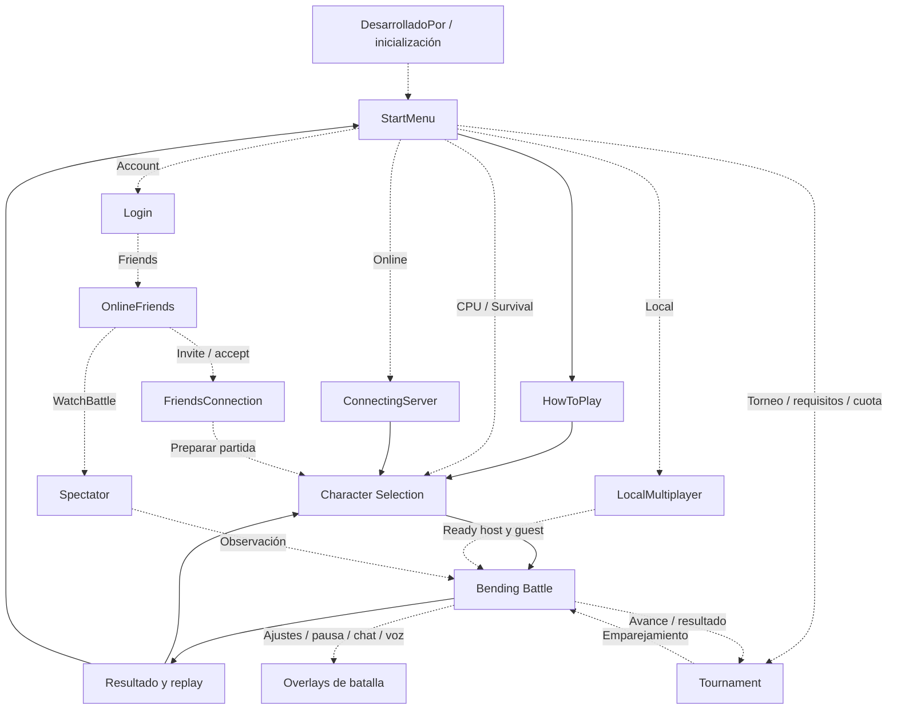

# Especificación de reconstrucción completa: True Masters

Esta es una especificación de recuperación, implementación y aceptación basada en evidencia. **No certifica que el juego esté reconstruido ni que todos sus comportamientos se comprendan.** El objetivo es un proyecto Unity editable que conserve recursos, escenas y comportamiento del objetivo elegido, con código mantenible. Un menú que abre una arena genérica, clases vacías o una exportación de assets no satisface ese objetivo.

## Fuentes, autoridad y límites

- **V**: [video-findings.json](video-findings.json), 45 observaciones/inferencias/incógnitas con ruta e intervalo. [video-analysis.md](video-analysis.md) explica el muestreo y enlaza fotogramas. No se escuchó audio ni se observó cada fotograma.
- **M**: [assembly-csharp-metadata.json](../Evidence/assembly-csharp-metadata.json), IL2CPP v39, SHA256 c79db4f28d92a0d5959ec74c3e8a2267b8838f7e924640096b5a811237eddfd4. La referencia “M tipo N, clase.miembro” selecciona types por index=N, no por posición del array. Son declaraciones de campos/métodos. No contienen implementación, ramas ni constantes conductuales validadas.
- **S**: [recovered-scenes-inventory.json](../Evidence/recovered-scenes-inventory.json) y [apk-scenes.md](apk-scenes.md). S:Assets/Scenes/X.unity identifica la escena y su hash registrado. Los nombres de GameObjects/componentes son hechos estáticos, no callbacks recuperados ni prueba de que una pantalla sea accesible.
- **A**: [apk-findings.json](../Evidence/apk-findings.json), [android-manifest-decoded.json](../Evidence/android-manifest-decoded.json), [recovered-project-inventory.json](../Evidence/recovered-project-inventory.json).
- **C**: [game-coverage.json](game-coverage.json), obligaciones estructuradas, declaraciones seleccionadas y referencias exactas. Los 33 subsistemas empiezan abiertos; su implementación no fue evaluada por este documento.

A identifica com.FacuRodquin.BendingBattle versión **2.99 (299)** y APK SHA256 51e274bd08fd72ff2be562960d21f31871c0318a1e99d9a5c193e4f5d6024c4d. El archivo original no contiene .so/.dll y requiere split base__abi. El APK aporta recursos Unity 6000.3.10f1 y declaraciones: 793 tipos, 3635 campos, 4143 métodos Assembly-CSharp. La exportación inicial usa clases dummy, campos MonoBehaviour ausentes y shaders dummy; las conclusiones sobre comportamiento no pueden apoyarse en ella como si contuviera código. La recuperación adicional con binarios nativos está en curso; debe evaluarse por separado antes de actualizar esta cobertura.

## Decisión de versión y roster

La versión de las grabaciones no está comprobada. No debe suponerse que muestra todas las capacidades de APK 2.99.

| Contrato/fuente | Catálogo observado o declarado | Implicación |
|---|---|---|
| V, selecciones | SORA, VINEA, DIANA, BLAZE, REN, RINA, DANTE, AURA | Ocho nombres mínimos; no catálogo exhaustivo |
| S Character Selection, nombres *View | Sora, Aura, Vinea, Eliot, Diana, Ren, Rina, Dante, Amon, Maya, Raven, Agata; además RandomView | Doce vistas con nombre de personaje, no doce personajes jugables confirmados |
| S Tournament, objetos con nombres | Los mismos doce nombres anteriores | Correspondencia estática, no participación demostrada |
| M tipo 3285 CharacterEnum y 3545 CharacterName | Sora, Aura, Vinea, Eliot, Diana, Ren | Enums parciales de un contrato; no usar como catálogo global |
| M tipo 3643 ElementType | Wind, Water, Earth, Fire, Electricity, Shadow | Seis familias declaradas; Shadow no mostrado en videos revisados |
| M tipo 3750 PlayerElement | Fire, Water, Earth, Air | Contrato parcial; no convertirlo sin evidencia en ElementType global |
| M tipo 3751 AtkName | Ataques Air/Water/Earth y variantes/specials | Identificadores posiblemente específicos de local; ausencia de Fire/Rayo no prueba falta de soporte |

**Discrepancia BLAZE:** aparece seleccionado en C 11:02 y 14:02 aproximadamente; no aparece un objeto Blaze/BlazeView en el inventario inicial Character Selection ni Tournament. No se sabe si se retiró, renombró, sustituyó o si pertenece a otra versión. Resolver con catálogo/prefabs/código/ejecución de la versión objetivo. No convertir BLAZE en RINA automáticamente.

**Obligación P0:** construir matriz por versión de personajes, escenarios, menús, reglas y fuentes. Fijar qué versión se reconstruye. Se puede recuperar estructura y recursos mientras se resuelve; no declarar fidelidad total combinando silenciosamente versiones.

## Inventario de escenas

Las cantidades son GameObjects, no todos los objetos Unity serializados; el JSON tiene objectCount aparte.

| Escena S:Assets/Scenes/ | GameObjects | Evidencia y pregunta principal |
|---|---:|---|
| DesarrolladoPor.unity | 70 | Presentación/inicialización; orden real de arranque pendiente |
| StartMenu.unity | 93 | Base_UI, MultiPlayer_UI, Account, Local, Online, Tournament, Survival, Test, PlayTeddies |
| HowToPlay.unity | 117 | Tutorial y gestión de su visualización |
| Character Selection.unity | 1471 | Personajes/vistas, CPU, nivel, duración, velocidad, tienda/desbloqueos y escenarios |
| ConnectingServer.unity | 65 | QuickPlay, CreateRoom, JoinRoom, CodePrivate, ShareCode, PhotonRoom |
| Bending Battle.unity | 415 | Combate, HUD, controles, vida/defensa, resultado, ajustes, chat/voz y recompensas |
| Tournament.unity | 129 | Brackets, rondas, Player-1..8, checkpoints, estrellas y resultado |
| LocalMultiplayer.unity | 357 | TCP/UDP, crear/buscar/listar salas, contraseña, selección/host/guest |
| Login.unity | 165 | Login/register/reset, cuenta, datos y LoadGoogleData |
| OnlineFriends.unity | 62 | Lista/peticiones/añadir/invitar/observar |
| FriendsConnection.unity | 41 | Conexión tras invitación; estados concretos pendientes |
| Spectator.unity | 23 | Entrada/configuración del espectador; operación real pendiente |

No excluir Test/PlayTeddies ni funciones aparentemente auxiliares sin resolver si son accesibles en la versión distribuida. Un objeto inactivo no prueba que nunca se active. Igualmente, un objeto presente no obliga a que el producto deba exponer un flujo de desarrollo no accesible: primero recuperar callbacks/condiciones.

## Grafo de menús y estados

Leyenda: flecha continua = transición visual observada entre conceptos; flecha punteada = candidata sustentada por escena/declaración. Los nombres de escenas asignados a conceptos visuales siguen siendo una correspondencia por confirmar. No se recuperaron todos los UnityEvent/callbacks en la primera exportación.

C.menu_edges contiene 17 aristas con su evidencia y límites. El diagrama incluye además el regreso de torneo y overlays como obligaciones/candidatos; no equivale a un grafo completo recuperado.

### Subflujos obligatorios que faltan en video

- Online: quickplay, crear privada, introducir código, cambiar región, esperando, sin partidas, código inválido, fallo/red desconectada, listo, espectador, salida. Base: S ConnectingServer y M Translation; no demostrar el flujo real solo por las claves.
- LAN: inicio → crear nombre/clave → esperar; buscar → sin salas/lista → contraseña → conectar; sincronización de selección/escenas → combate; cancelación, timeout y desconexión. Base: S LocalMultiplayer; M tipos 3359,3512,3547,3546,3970,3897.
- Cuenta: login/register/reset/logout, confirmar carga de datos, cuenta/estadísticas y modo sin red. Amigos: buscar/añadir/peticiones/aceptar/borrar/invitar/observar. Base: S Login/OnlineFriends/FriendsConnection; M tipos 3766,3463,3721.
- Torneo: requisitos y cuota → cuadro/round → duelo → avance/derrota → final/recompensa/replay. Base: S Tournament; M tipos 3896,3978,3337,3600,3979. Formato exacto, coste y persistencia desconocidos.
- Selección: personaje/CPU/nivel/velocidad/tiempo/escenario → bloqueado/requisitos/precio → desbloquear/tienda → listo. Base: S Character Selection; M 3845,3483,3674,3872,3942.
- Ajustes: pausa/resume/quit/replay, calidad/resolución/FPS/audio/controles/inversión. Base: S Bending Battle y M 3914,3730,3726,3522,3980. Valores concretos y panel visual pendientes.

## Contratos de combate que sí están fijados visualmente

Fuente V tutorial y video-frames/tutorial-5s.png: joystick para movimiento; A para ataque; B para defensa. Neutro/derecha/izquierda/abajo/arriba + A corresponde BASIC/RIGHT/LEFT/DOWN/UP ATK. Las mismas direcciones + B corresponden BLOCK/JUMP R/JUMP L/BACKFLIP/ROLL. BASIC ATK (LV1), DOWN ATK (LV2), UP ATK (LV3) son etiquetas observadas, no prueba de la ecuación de potencia o disponibilidad por nivel.

M 3507 InputSet declara x,y,a,b,s; M 3508 InputReader declara SetAButton/SetBButton/SetSButton y dPad/keyboard. Eso guía recuperación del dueño de interpretación de entradas. No fijar la zona muerta o la prioridad de botones por intuición.

S/X requiere recuperación: V muestra X y luego S; M 3866 SpecialAtk expone charge, newCharge, lastCharge, speed, letter, charged, numberOfSpecial y ChargeSpecial/ResetCharge/DechargeSpecial. M 3725 GameController declara EnableSpecial/DisableSpecial/Special e IsPlayerWeak; AI declara awakening/Special/Special2. Estos nombres sugieren estados de carga y variantes pero no establecen reglas, coste o significado de X. Mantener esas decisiones abiertas hasta recuperar implementación o medir interacción.

Daño/escudo también es obligación: M 3644 AttackData incluye elementType, powerLevel, jumpable, explotion, GetDamage y GetDefense; M 3642 PowerLevel incluye Lv1/Lv2/Lv3/Indestructible; M 3822 PlayerStats incluye lifes/defense y LoseLife/LoseDefense; M 3496 HitController incluye IsShieldBroken/GetAngleDiference. El código reconstruido deberá tener un dueño único de esas reglas; evitar atribuir daño por nombre del efecto.

M 3651 AI enumera perfiles y métodos de matchup. Una CPU que solo persigue o lanza proyectiles aleatorios no satisface la recuperación de dificultad y decisiones originales.

## Subsistemas y obligaciones de aceptación

### P0 — Versiones y procedencia [version-provenance]

**Evidencia:** V:menu-main, V:char-sora, V:char-aura; M 3285 CharacterEnum; M 3545 CharacterName; M 3643 ElementType; M 3884 GameMode. S:Assets/Scenes/StartMenu.unity; S:Assets/Scenes/Character Selection.unity.

**Alcance conocido/declarado:** El APK suministrado es 2.99(299); los videos no muestran una versión verificable. Su interfaz/roster no delimita el catálogo actual.

**Recuperar e implementar:** Fijar APK, splits y recursos por versión; comparar layout, roster y controles en ejecución antes de aplicar constantes del video al APK.

**Aceptación exigida:** Identidad y hash del conjunto documentados; matriz que marca cada diferencia APK/video y decisión explícita de objetivo.

### P0 — Proyecto Unity editable y ejecutable [project-runtime]

**Evidencia:** Sin observación visual en el corpus; Sin declaración seleccionada en este mapa. .

**Alcance conocido/declarado:** Exportar recursos y clases vacías no demuestra compilación ni comportamiento.

**Recuperar e implementar:** Terminar recuperación asistida por binarios y revisar scripts, referencias serializadas, shaders, rigs, SDK y escenas; importar con versión Unity apropiada.

**Aceptación exigida:** Editor compila sin clases dummy usadas como lógica; escenas abren; flujo de arranque y build Android se ejecutan con evidencia.

### P1 — Inicio, versión y ciclo de aplicación [boot]

**Evidencia:** V:menu-main; M 3886 SystemManager; M 3737 InitialConfig; M 3943 StarMenuManager. S:Assets/Scenes/DesarrolladoPor.unity; S:Assets/Scenes/StartMenu.unity.

**Alcance conocido/declarado:** Escenas de inicio y métodos de actualización existen; su orden y efectos no están demostrados.

**Recuperar e implementar:** Recuperar BuildSettings, inicializadores, DontDestroyOnLoad y cambios de escena; definir comportamiento offline, actualización y salida.

**Aceptación exigida:** Arranque frío/caliente, regreso al menú y suspensión/reanudación conservan estado apropiado.

### P1 — Menú principal y navegación [navigation]

**Evidencia:** V:menu-main, V:menu-social, V:disconnect; M 3943 StarMenuManager; M 3884 GameMode; M 3980 Translation. S:Assets/Scenes/StartMenu.unity.

**Alcance conocido/declarado:** Video muestra seis botones; APK añade objetos de cuenta y submenú multiplayer.

**Recuperar e implementar:** Recuperar callbacks y estados activos; evitar ocultar cuentas/local/friends/spectator por no estar en los videos.

**Aceptación exigida:** Todos los destinos del objetivo de versión son navegables, con retorno/cancelación y mensajes de error.

### P1 — Tutorial y niveles [tutorial]

**Evidencia:** V:tutorial, V:attack-directions, V:defense-directions, V:attack-levels; M 3502 HowToPlayManager; M 3980 Translation. S:Assets/Scenes/HowToPlay.unity; S:Assets/Scenes/Bending Battle.unity.

**Alcance conocido/declarado:** Tutorial comprobado, significado exacto del nivel pendiente.

**Recuperar e implementar:** Cruzar texto y callbacks con modelos InputSet/AttackData; conservar tabla direccional; determinar primera aparición y opción de reapertura.

**Aceptación exigida:** Las diez entradas reproducen acciones correctas; tutorial, omisión y persistencia se verifican.

### P1 — Entrada táctil, Dpad, teclado y mando [input]

**Evidencia:** V:attack-directions, V:defense-directions, V:hud-duel; M 3507 InputSet; M 3508 InputReader; M 3522 JoystickSettings; M 3772 MobileInputs; M 3683 DesktopInputs. S:Assets/Scenes/Bending Battle.unity.

**Alcance conocido/declarado:** Hay declaraciones para teclado, Dpad, controller e inversión; no se sabe cuáles son activas en cada plataforma.

**Recuperar e implementar:** Recuperar umbrales, zonas muertas, orientación, prioridades A/B/S, hold/release, cancelación, layouts y mapeos.

**Aceptación exigida:** Matriz de todas las entradas con resultados por dispositivo, simultaneidad y pérdida de foco.

### P1 — Personajes, variantes y disponibilidad [roster]

**Evidencia:** V:char-sora, V:char-vinea, V:char-diana, V:char-blaze, V:char-ren, V:char-rina, V:char-dante, V:char-aura; M 3845 SelectionController; M 3336 CharactersManager; M 3338 CharacterSwap; M 3270 AltCharacter; M 3285 CharacterEnum; M 3545 CharacterName; M 3892 TMPlayerCharacters; M 3643 ElementType. S:Assets/Scenes/Character Selection.unity; S:Assets/Scenes/Tournament.unity.

**Alcance conocido/declarado:** Ocho nombres observados en video; APK contiene además Eliot/Amon/Maya/Raven/Agata. No afirmar número final ni equivalencia entre variantes.

**Recuperar e implementar:** Recuperar lista Characters, prefabs, orden, nombres traducidos, precios, restricciones y variantes; resolver enums parciales frente a escena más amplia.

**Aceptación exigida:** Cada personaje del catálogo objetivo selecciona su prefab/animaciones/movimientos y guardado correctos.

### P1 — Selección de rival y parámetros [selection]

**Evidencia:** V:cpu-config, V:survival-select; M 3845 SelectionController; M 3674 CPUController; M 3483 GameSpeed. S:Assets/Scenes/Character Selection.unity.

**Alcance conocido/declarado:** LV3 observado; Translation declara LV1-LV5; campo times y GameSpeed pueden ampliar opciones.

**Recuperar e implementar:** Recuperar nivel/duración/velocidad, random ?, valores permitidos y sincronización ready del online/local.

**Aceptación exigida:** Parámetros escogidos llegan a la batalla y son consistentes al volver/jugar de nuevo.

### P1 — Escenarios y límites [stages]

**Evidencia:** V:stage-picker, V:survival-play, V:fall-loss; M 3942 StagesManager; M 3872 StageSelector; M 3871 StageController; M 3899 UnlockStage. S:Assets/Scenes/Character Selection.unity; S:Assets/Scenes/Bending Battle.unity.

**Alcance conocido/declarado:** Algunos escenarios y bordes visibles; número, escala, colisión y catálogo no confirmados.

**Recuperar e implementar:** Recuperar assets stages/playableStages, colisionadores, DeathZone/FinalZone, música, skybox y bloqueos.

**Aceptación exigida:** Todos los escenarios del objetivo cargan con spawn, cámara, límites y desbloqueos correctos.

### P1 — Movimiento, orientación y física [movement]

**Evidencia:** V:camera, V:fall-loss; M 3636 Character; M 3725 GameController; M 3496 HitController. S:Assets/Scenes/Bending Battle.unity.

**Alcance conocido/declarado:** Clases exponen moveSpeed/rotationSpeed; no hay constantes validadas.

**Recuperar e implementar:** Recuperar curvas, gravedad, control aéreo, saltos/rodar/backflip, colisión y edge behavior de todas las variantes.

**Aceptación exigida:** Trayectorias y tiempos comparados contra referencia con tolerancias explícitas.

### P1 — Cámara y vistas [camera]

**Evidencia:** V:camera, V:hud-top; M 3664 CameraManager. S:Assets/Scenes/Bending Battle.unity.

**Alcance conocido/declarado:** Vista trasera observada; declaraciones distinguen close/far/scene/winner.

**Recuperar e implementar:** Recuperar rigs y transiciones, eye toggle, spectator, colisiones y sensibilidad.

**Aceptación exigida:** Encuadre de ambos jugadores, bordes y resultados comprobado en arenas y resoluciones objetivo.

### P1 — Ataques por elemento y potencia [attacks]

**Evidencia:** V:air-demo, V:water-demo, V:earth-demo, V:fire-demo, V:lightning-demo; M 3280 AttacksManager; M 3644 AttackData; M 3645 Attack_SO; M 3642 PowerLevel; M 3643 ElementType; M 3751 AtkName; M 3725 GameController. S:Assets/Scenes/Bending Battle.unity.

**Alcance conocido/declarado:** Cinco familias vistas; Shadow declarado; AtkName es parcial y no define todo el repertorio.

**Recuperar e implementar:** Inventariar prefabs/clips/eventos por personaje y entrada; recuperar daño/defensa, alcance, spawn, velocidad, lifespan y capas.

**Aceptación exigida:** Tabla completa por personaje/entrada y pruebas de colisión, potencia, bloqueabilidad y limpieza.

### P1 — Vida, escudo, impactos y estados [defense]

**Evidencia:** V:defense-directions, V:fall-loss; M 3822 PlayerStats; M 3496 HitController; M 3952 StatsController; M 3644 AttackData. S:Assets/Scenes/Bending Battle.unity.

**Alcance conocido/declarado:** lifes/defense, GetDamage/GetDefense, IsShieldBroken declarados; video no basta para deducir ecuaciones.

**Recuperar e implementar:** Recuperar defensa, agotamiento, regen, stun, knockback, invulnerabilidad y compatibilidad de niveles.

**Aceptación exigida:** Casos hit/block/shield-break, múltiples impactos, choque simultáneo y ringout medidos.

### P1 — Especial, carga y estados S/X [special]

**Evidencia:** V:hud-duel, V:combat-unknown; M 3866 SpecialAtk; M 3725 GameController; M 3508 InputReader; M 3651 AI. S:Assets/Scenes/Bending Battle.unity.

**Alcance conocido/declarado:** ChargeSpecial/ResetCharge/DechargeSpecial y EnableSpecial declarados; nombres no prueban cuál es el disparador o significado de X.

**Recuperar e implementar:** Recuperar cálculo de carga, daño recibido/dado, estado cargado, posibles especiales múltiples/awakening y transiciones del botón.

**Aceptación exigida:** Para cada personaje se documentan activación, coste, ejecución, reset, muerte y sincronización; fidelidad no afirmada antes.

### P1 — Duelo, contador y victoria [duel-score]

**Evidencia:** V:rounds, V:first-to-three, V:countdown, V:fall-loss; M 3725 GameController; M 3816 ScoreController; M 3822 PlayerStats; M 3791 NormalMode. S:Assets/Scenes/Bending Battle.unity.

**Alcance conocido/declarado:** Primero a tres compatible con muestras; puede variar con versión/modo/vida/tiempo.

**Recuperar e implementar:** Recuperar reglas de punto, draw, vida, timeout, respawn, reinicio, fin de batalla y desconexión.

**Aceptación exigida:** Matriz de puntuación y resultado cubre empate, caída, victoria y abandono en cada modo.

### P1 — CPU y dificultad [ai]

**Evidencia:** V:cpu-config, V:air-demo, V:water-demo, V:earth-demo, V:fire-demo, V:lightning-demo; M 3651 AI; M 3674 CPUController. S:Assets/Scenes/Character Selection.unity; S:Assets/Scenes/Bending Battle.unity.

**Alcance conocido/declarado:** AI declara Lv1/Lv2/Lv3 y perfiles Noob/Easy/Normal/Hard/Pro/Legend, matchups y evasión; selección expone potencialmente LV1-LV5.

**Recuperar e implementar:** Recuperar funciones, estado, temporizadores, detección, azar y relación nivel/perfil/modo; no sustituir por proyectil aleatorio y llamarlo completo.

**Aceptación exigida:** Cada dificultad/modo y matchup relevante produce decisiones verificadas sin entrada humana.

### P1 — Supervivencia [survival]

**Evidencia:** V:survival-play, V:survival-result, V:survival-award-inference; M 3880 SurvivalController; M 3886 SystemManager; M 3829 ResultsController. S:Assets/Scenes/Character Selection.unity; S:Assets/Scenes/Bending Battle.unity.

**Alcance conocido/declarado:** Score y premio vistos; reglas de respawn/escalado y fin desconocidas.

**Recuperar e implementar:** Recuperar secuencia enemigos, puntuación, daño/vida, récord, spawn y escalado.

**Aceptación exigida:** Partidas completas cubren progresión, muerte, récord y premio persistido.

### P1 — Torneo y cuadros [tournament]

**Evidencia:** V:tournament-unknown; M 3896 TournamentController; M 3978 TournamentManager; M 3337 CharactersTournament; M 3600 PlayerCheckpointsProgress; M 3979 TourneyLevel; M 3943 StarMenuManager. S:Assets/Scenes/Tournament.unity; S:Assets/Scenes/StartMenu.unity; S:Assets/Scenes/Bending Battle.unity.

**Alcance conocido/declarado:** APK contiene Brackets, Player-1..8, rondas/checkpoints y entrada con coste; no prueba formato/reglas exactos.

**Recuperar e implementar:** Recuperar cuota, requisitos, ocho jugadores candidatos, shuffle, avance, derrota, dificultad, reentrada, recompensas y guardado.

**Aceptación exigida:** Torneo completo verificable desde pago/requisito hasta ganador; derrota, retorno y restauración cubiertos.

### P1 — Multijugador local LAN [local]

**Evidencia:** Sin observación visual en el corpus; M 3884 GameMode; M 3547 LocalMultiplayerManager; M 3546 LocalMultiplayerData; M 3359 CreateRoomManager; M 3512 JoinRoomManager; M 3970 TCPConnection; M 3897 UDPConnectionManager. S:Assets/Scenes/LocalMultiplayer.unity; S:Assets/Scenes/Bending Battle.unity.

**Alcance conocido/declarado:** Declaraciones indican descubrimiento UDP, sala/clave y conexión TCP; no equivale a dos jugadores en un mismo teclado.

**Recuperar e implementar:** Recuperar protocolo real, permisos LAN, host/guest, formato/mensajes/orden, escenas ready, desconexión, inputs y reconciliación.

**Aceptación exigida:** Dos dispositivos reales descubren, crean, unen y completan partida; errores y cancelación cierran sockets/threads.

### P1 — Multijugador online y autoridad [online]

**Evidencia:** V:online-lobby, V:online-feedback, V:online-result, V:disconnect; M 3811 PhotonRoom; M 3725 GameController; M 3884 GameMode; M 3980 Translation. S:Assets/Scenes/ConnectingServer.unity; S:Assets/Scenes/Bending Battle.unity.

**Alcance conocido/declarado:** Photon room callback declarations and components establish integration presence, not a working accessible backend or trust/authority model.

**Recuperar e implementar:** Recuperar room properties, región, quickplay/private code, contador sincronizado, autoridad, RPC/eventos, recreación/destrucción y salida; definir servicio propio si falta.

**Aceptación exigida:** Dos clientes separados completan partidas; latencia/pérdida/reconexión y autoridad documentadas sin depender de una UI simulada.

### P2 — Amigos, invitaciones y perfiles [friends]

**Evidencia:** Sin observación visual en el corpus; M 3721 FriendsController; M 3463 FirebaseController; M 3766 FirebaseManager. S:Assets/Scenes/OnlineFriends.unity; S:Assets/Scenes/FriendsConnection.unity; S:Assets/Scenes/Login.unity.

**Alcance conocido/declarado:** APK contiene listas/peticiones/invitar/WatchBattle; videos no los muestran.

**Recuperar e implementar:** Recuperar IDs, peticiones/aceptación/borrado, presencia, invitación y caducidad; separar identidad local de usuario remoto.

**Aceptación exigida:** Dos cuentas de prueba ejercitan ciclos completos y fallos sin servicios originales implícitos.

### P2 — Espectador [spectator]

**Evidencia:** Sin observación visual en el corpus; M 3884 GameMode; M 3725 GameController; M 3721 FriendsController; M 3811 PhotonRoom. S:Assets/Scenes/Spectator.unity; S:Assets/Scenes/OnlineFriends.unity; S:Assets/Scenes/Bending Battle.unity.

**Alcance conocido/declarado:** Modo/escena/métodos de espectador existen; semántica y autorización no demostradas.

**Recuperar e implementar:** Recuperar ruta WatchBattle/StartAsSpectator y observación, cámara, capacidad y salida.

**Aceptación exigida:** Cliente espectador ve partida real y sale; nunca altera autoridad o puntuación.

### P2 — Chat de texto [chat]

**Evidencia:** V:chat, V:chat-exchange; M 3576 OnlineChat. S:Assets/Scenes/Bending Battle.unity.

**Alcance conocido/declarado:** Intercambio y typing vistos; transporte, límite y vida de historial desconocidos.

**Recuperar e implementar:** Recuperar orden, identidad, teclado/safe area, typing, alertas, desconexión y estado rematch.

**Aceptación exigida:** Mensajes entre dos clientes se ordenan y muestran en estados correctos.

### P2 — Voz y micrófono [voice]

**Evidencia:** Sin observación visual en el corpus; M 3904 VoiceChatManager. S:Assets/Scenes/Bending Battle.unity; S:Assets/Scenes/Character Selection.unity.

**Alcance conocido/declarado:** Declaraciones StartRecording/StopRecording/MuteAll y callbacks permisos; no prueba audio en video.

**Recuperar e implementar:** Recuperar proveedor, permisos, creación/destrucción y mute; estados denegado/ausente/desconexión.

**Aceptación exigida:** Dos clientes validan permisos y voz/mute; release limpia stream/micrófono.

### P2 — Cuenta, login y nube [account]

**Evidencia:** Sin observación visual en el corpus; M 3766 FirebaseManager; M 3463 FirebaseController; M 3661 AuthManager; M 3681 DatabaseManager; M 3486 GPGSManager. S:Assets/Scenes/Login.unity.

**Alcance conocido/declarado:** Login/register/reset/Google-load/estadísticas presentes en escena y declaraciones; posible legado/coexistencia sin determinar.

**Recuperar e implementar:** Recuperar componentes activos, backend schema, flujo guest, carga/confirmación de datos, errores y políticas de conflicto.

**Aceptación exigida:** Registro/login/reset/logout y offline fallan o completan de forma explícita sin fingir servidor.

### P1 — Guardado local y sincronización [save]

**Evidencia:** V:survival-select, V:survival-result, V:cpu-rewards; M 3886 SystemManager; M 3463 FirebaseController; M 3891 TMPlayer; M 3892 TMPlayerCharacters; M 3893 TMPlayerStages. S:Assets/Scenes/StartMenu.unity; S:Assets/Scenes/Login.unity; S:Assets/Scenes/Character Selection.unity.

**Alcance conocido/declarado:** SaveManager no tiene miembros en este extracto; SystemManager y FirebaseController sí declaran guardado. Nombres no establecen el formato.

**Recuperar e implementar:** Recuperar modelo jugador, claves/formato/versionado y dueño de cada dato, valores iniciales, migraciones, offline/cloud y atomicidad.

**Aceptación exigida:** Cierre/reinicio, datos malformados y conflicto de nube no duplican/revierten premios o compras.

### P1 — Crystals, trofeos, récords y desbloqueos [economy]

**Evidencia:** V:survival-result, V:cpu-rewards, V:survival-award-inference; M 3845 SelectionController; M 3829 ResultsController; M 3891 TMPlayer; M 3942 StagesManager; M 3899 UnlockStage. S:Assets/Scenes/Character Selection.unity; S:Assets/Scenes/Bending Battle.unity; S:Assets/Scenes/StartMenu.unity.

**Alcance conocido/declarado:** Premios observados de versión no confirmada; existen precios/trofeos/requisitos de escenario/personaje.

**Recuperar e implementar:** Recuperar fórmulas rank/reward, saldo, condición de desbloqueo y coste/reembolso/duplicación.

**Aceptación exigida:** Cada transacción y recompensa tiene regla trazable, persistencia y cobertura de saldo insuficiente.

### P2 — Anuncios, bonus y compras [ads-iap]

**Evidencia:** V:survival-result; M 3729 GoogleAdsManager; M 3829 ResultsController; M 3828 RestorePurchases. S:Assets/Scenes/Character Selection.unity; S:Assets/Scenes/Bending Battle.unity.

**Alcance conocido/declarado:** GoogleAdsManager declara interstitial/rewarded; escena incluye IAPManager pero no se encontró ese tipo entre las declaraciones seleccionadas Assembly-CSharp.

**Recuperar e implementar:** Identificar assembly SDK IAP y callbacks; recuperar unidades/estado/cancelación/error y entitlement; usar configuración propia/test para servicios de reconstrucción.

**Aceptación exigida:** Bonus se entrega exactamente una vez tras éxito; no-fill/cancel/error no lo entregan; compra/restauración verificadas con proveedor de prueba.

### P2 — Ajustes gráficos, audio y controles [settings]

**Evidencia:** V:settings-unknown, V:hud-top; M 3914 SettingsOptions; M 3730 GraphicsManager; M 3726 GameManager; M 3522 JoystickSettings; M 3562 MusicController; M 3563 MuteController; M 3980 Translation. S:Assets/Scenes/Bending Battle.unity.

**Alcance conocido/declarado:** 30 FPS, resolución MIN/MED/MAX, quality, music/mute, joystick/Dpad/controller/Inv aparecen en declaraciones/objetos, no panel visual confirmado.

**Recuperar e implementar:** Recuperar callbacks y constantes, persistencia, defaults, presentación y adaptación móvil.

**Aceptación exigida:** Cada opción cambia el sistema esperado, persiste según contrato y conserva rendimiento/legibilidad.

### P2 — Traducciones y textos [localization]

**Evidencia:** V:menu-main, V:tutorial; M 3980 Translation. S:Assets/Scenes/StartMenu.unity; S:Assets/Scenes/HowToPlay.unity; S:Assets/Scenes/Bending Battle.unity; S:Assets/Scenes/Login.unity.

**Alcance conocido/declarado:** Clase Translation contiene nombres de claves, no necesariamente los textos o todos los idiomas.

**Recuperar e implementar:** Recuperar tablas de idioma/fontes/selección y fallback; no reemplazar silenciosamente textos originales con claves.

**Aceptación exigida:** Todos los menús soportados y estados de fallo resuelven textos y glifos.

### P1 — Modelos, rigs, animaciones, materiales y VFX [assets]

**Evidencia:** V:air-demo, V:water-demo, V:earth-demo, V:fire-demo, V:lightning-demo, V:camera; M 3338 CharacterSwap; M 3280 AttacksManager; M 3664 CameraManager. S:Assets/Scenes/Character Selection.unity; S:Assets/Scenes/Bending Battle.unity.

**Alcance conocido/declarado:** Export inicial contiene recursos pero shaders dummy y scripts sin campos; export asistido pendiente de evaluación.

**Recuperar e implementar:** Conservar IDs/GUIDs y vínculos, verificar skins/avatar/animator/root motion/eventos, colisión y shaders/URP.

**Aceptación exigida:** Cada personaje y ataque tiene vista/animación/VFX/material correctos; sin recursos faltantes ni apariencias genéricas presentadas como finales.

### P2 — Música y efectos [audio]

**Evidencia:** Sin observación visual en el corpus; M 3562 MusicController; M 3563 MuteController. S:Assets/Scenes/Bending Battle.unity; S:Assets/Scenes/Tournament.unity; S:Assets/Scenes/StartMenu.unity.

**Alcance conocido/declarado:** No se escuchó audio; export inicial contiene clips OGG.

**Recuperar e implementar:** Inventariar clips y bindings de escenas/animaciones, volumen/fades, mute y mezcla.

**Aceptación exigida:** Música de fases y sonido de acciones comparados por escucha y eventos.

### P1 — Rendimiento, dispositivos y ciclo de recursos [reliability]

**Evidencia:** V:camera; M 3726 GameManager; M 3730 GraphicsManager; M 3886 SystemManager; M 3970 TCPConnection; M 3897 UDPConnectionManager; M 3904 VoiceChatManager. S:Assets/Scenes/Bending Battle.unity; S:Assets/Scenes/LocalMultiplayer.unity; S:Assets/Scenes/StartMenu.unity.

**Alcance conocido/declarado:** No hay medición runtime, build Android ni batería de dispositivos validada aquí.

**Recuperar e implementar:** Verificar safe area/aspectos, pausa Android, cleanup de sockets/voz/objetos, serialización, pool/GC y tiempo/frame en dispositivos objetivo.

**Aceptación exigida:** Resultados medidos de CPU/memoria/frame y estabilidad de partidas largas; cancelación sin recursos retenidos.

## Orden de trabajo y evidencia necesaria para cerrar brechas

1. **P0: fuente e integridad.** Emparejar APK/splits/versión/ABI, preservar hashes, evaluar exportación con nativos. Comprobar recuperación de tipos/campos serializados y distinguir decompilación con cuerpo frente a declaraciones o stubs. Registrar qué ensamblados/SDK siguen faltando. Un export que termina correctamente no demuestra que Unity compile.
2. **P0: versión objetivo y trazabilidad.** Resolver roster antiguo/BLAZE frente a APK299, Shadow y funciones nuevas. Construir catálogo único desde su dueño real, con IDs estables y referencias al prefab/datos, sin reinterpretar varios enums parciales como uno global.
3. **P1: escena original y flujo offline completo.** Restaurar assets/vínculos, menú/tutorial/selección y todas las variantes de combate; input/vida/defensa/ataques/S-X/puntuación/AI/survival/torneo/economía/guardado requieren comportamiento concreto, no botones decorativos. Una vertical slice puede ayudar a validar el pipeline pero debe etiquetarse incompleta.
4. **P1/P2: sistemas conectados completos.** LAN, online, cuenta/nube, amigos/espectador, texto/voz, compras/anuncios. Elegir explícitamente servicio propio, emulador local o equivalencia de test cuando el backend original no se recupere. Una adaptación de arquitectura debe registrarse como adaptación. No afirmar que código/configuración cliente recupera un backend.
5. **P2: presentación y plataforma.** Ajustes, idiomas, audio, cámaras, dispositivos y rendimiento. Importar assets originales sin restablecer shaders/animaciones/eventos puede conservar inventario y perder fidelidad.
6. **Aceptación total.** Ejecutar matriz de modo × personaje × escenario × entrada/estado relevante, ciclos de reinicio, pérdida de red y persistencia. Documentar alcance medido, tolerancias y casos aún no cubiertos. No se ejecutó esa matriz como parte de esta especificación.

Los rangos temporales no se infieren de separación entre capturas. Para medir cooldown, hitstun, invulnerabilidad, velocidad y física se necesitan implementación recuperada o grabaciones controladas de entrada y salida con suficiente resolución temporal. Los valores de una reconstrucción inicial podrán ser provisionales, siempre etiquetados como tales en el registro de decisiones y fuera del corpus de hechos observados.

## RAG, procedencia y uso al programar

La recuperación debe devolver el fragmento, ID, fuente y estatus. Una consulta sobre “S especial” debe devolver hud-duel/combat-unknown y declaraciones M3866/M3725 con sus límites; no transformar “ChargeSpecial existe” en “se carga cada 10 segundos”. Separar fuentes de video, APK299, código decompilado futuro, observación runtime y decisiones de reconstrucción.

Cada cierre de brecha en C debe añadir evidencia de implementación/ejecución y quién decidió una adaptación. No sobreescribir unknown con inferred sin conservar procedencia. Las etapas y 33 entradas abiertas son una lista de trabajo, no una estimación porcentual de progreso ni prueba de imposibilidad.

